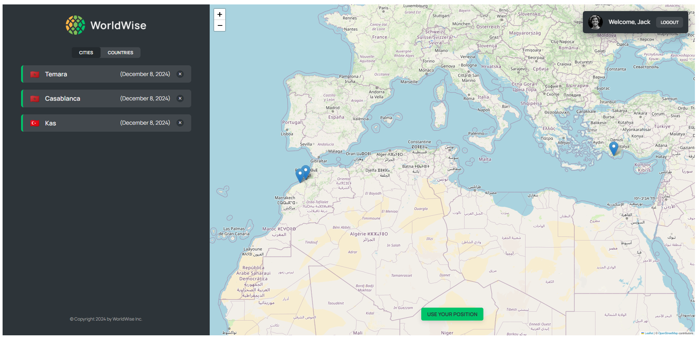

# WorldWise



A React and Leaflet learning application for recording cities on a map. Authentication is simulated for the exercise; city data is served by a local json-server backend.

Learning project built while following [The Ultimate React Course](https://www.udemy.com/course/the-ultimate-react-course/) by Jonas Schmedtmann. The application concept and course design come from the course; this repository contains my course implementation. It is retained as learning work.

Hosted demo link (availability has not been verified):
[WorldWise](https://worldwise-map-abdousadik.netlify.app/)

---

### Table of Contents

- [Description](#description)
- [Technologies](#technologies)
- [Getting Started](#getting-started)
- [References](#references)

---

## Description

WorldWise allows users to:

- Use a simulated login to access the exercise UI. Credentials are checked entirely in client code; this is not real authentication.
- Click on any location on the map to open a form.
- Submit the form to save visited or planned cities.
- View saved locations displayed directly on the map.

---

## Technologies

- **React**
- **Leaflet**
- **React Router**

---

## Getting Started

To set up and run the project locally:

1. Clone the repository:
   ```bash
   git clone https://github.com/abdousadik/worldwise-map.git
   ```
2. Navigate to the project directory:
   ```bash
   cd worldwise-map
   ```
3. Install dependencies:
   ```bash
   npm ci
   ```
4. Start the local city-data API in one terminal:
   ```bash
   npx --no-install json-server data/cities.json --port 8000
   ```
   The app requests `http://localhost:8000/cities`. This local exercise server writes changes to the JSON file; use sample data only. The existing `npm run server` script contains a stray `delay 500` argument, so use the explicit command above. Repairing the script is a separate application change.

5. In a second terminal, start the frontend:
   ```bash
   npm run dev
   ```

---

[Back To The Top](#worldwise)

## References

[The Ultimate React Course — Jonas Schmedtmann](https://www.udemy.com/course/the-ultimate-react-course/)

Retained as course-based learning work. The hosted demo requires a separately reachable API; the local setup above does not establish a production backend.
